# CARD-01B / A10 / RT-09 visual evidence

状态：`captured`（2026-10-26）

这些截图来自真实页面与真实服务端投影，不是组件截图或拼图：

- 运行方式：`pnpm test:e2e --runtime=scripted --spec="card-ui-interactions.spec.ts|peer-messages.spec.ts"`。
- 数据库：一次性 `workpal_e2e_*` PostgreSQL 库，先迁移后跑；每个测试新建账号与 Bot，不包含真实用户数据。
- A10 fixture 通过 `/__e2e/outbound-draft` 调用生产 `pauseRunForInput` 写入真实的 `send_email` ExternalEffect 与 approval Intervention，再从正常页面打开卡片；没有伪造前端状态。
- 截图由 `captureScreenshot()` 在 Playwright 断言通过后直接截取；390/375 截图同时断言页面无横向溢出。
- 截图文件：[docs/cards/evidence/card-ui-interactions](./evidence/card-ui-interactions/)。

## 卡片视觉

| 场景 | 实际截图 | 对照原型 |
| --- | --- | --- |
| 统一 MCP assignment 卡（桌面） | 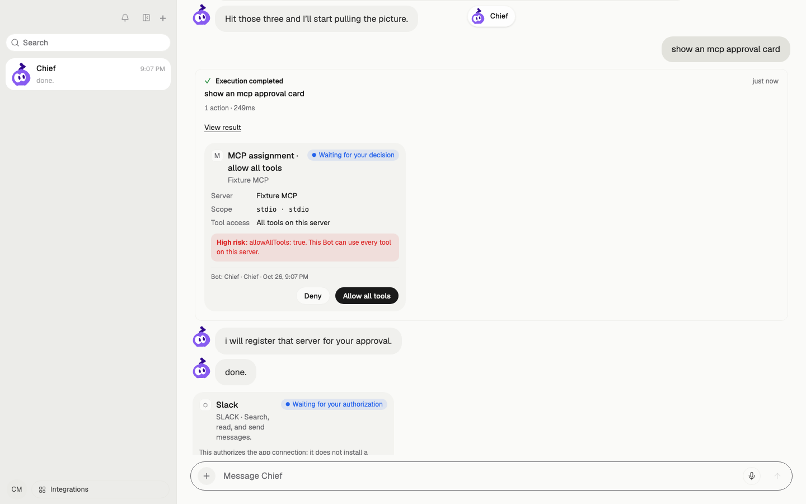 | [cards overview](./source/card-unification-v2/mockup/cards-hifi-v4/shot-cards.png) |
| 统一 MCP assignment 卡（390） | 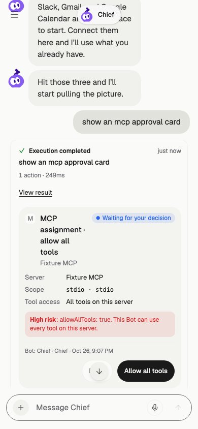 | [mobile 390](./source/card-unification-v2/mockup/cards-hifi-v4/shot-mobile-390.png) |
| 统一 MCP assignment 卡（375） | 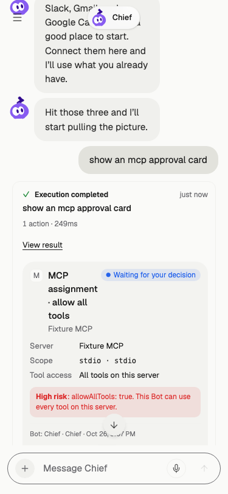 | [mobile 375](./source/card-unification-v2/mockup/cards-hifi-v4/shot-mobile-375.png) |
| 终态 MCP 卡（深色） | 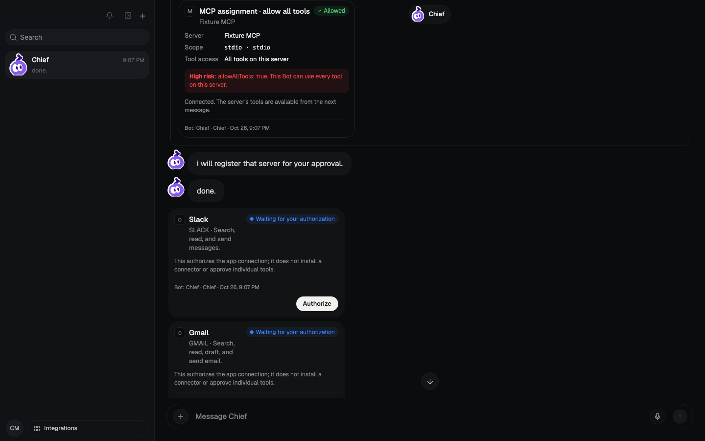 | [states](./source/card-unification-v2/mockup/cards-hifi-v4/shot-c-states.png) |
| 统一 tool approval 卡 | 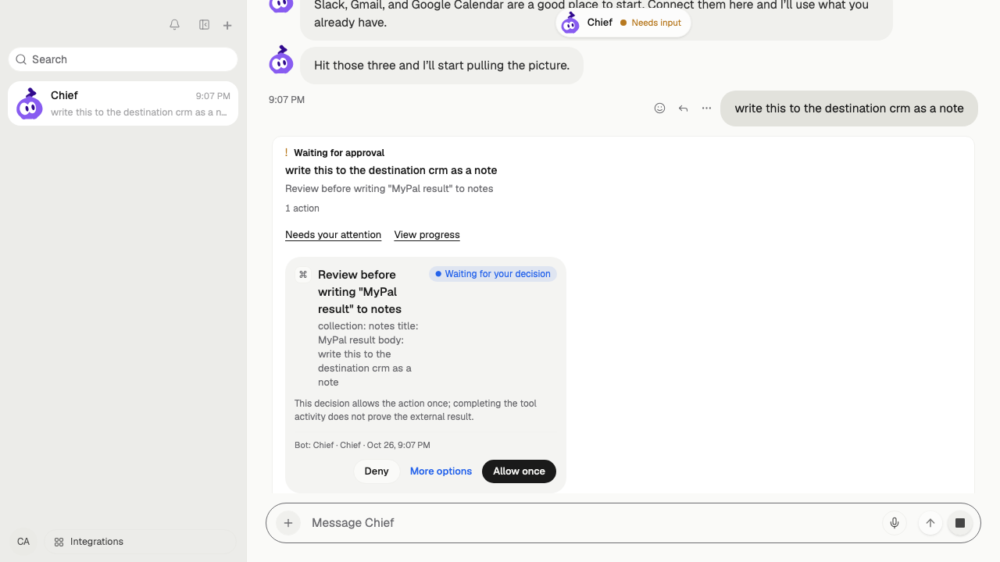 | [cards overview](./source/card-unification-v2/mockup/cards-hifi-v4/shot-cards.png) |

## A10 同卡编辑与确认

| 场景 | 实际截图 | 对照原型 |
| --- | --- | --- |
| r1 待处理卡 | 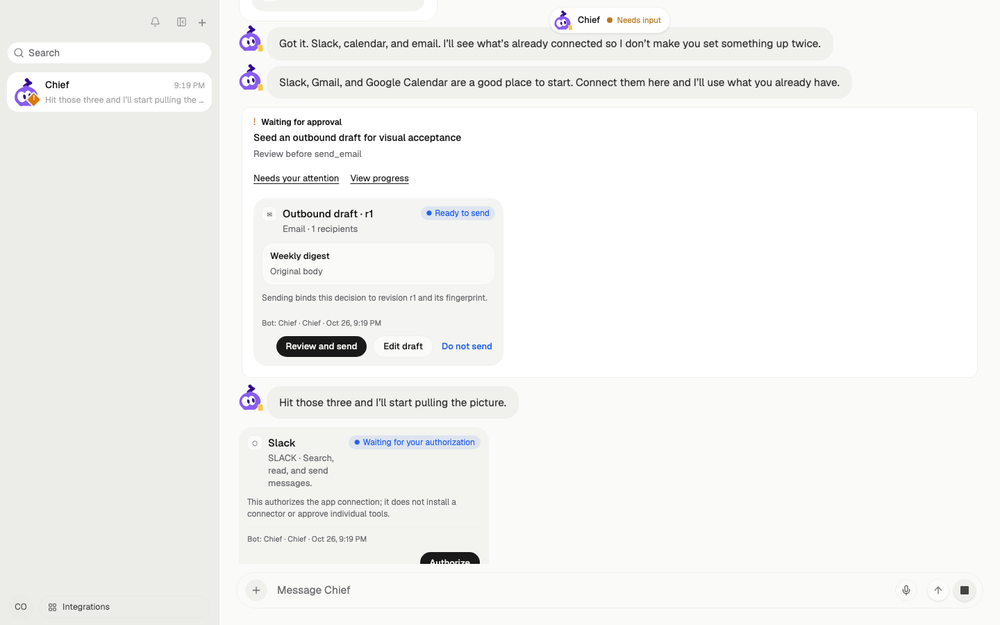 | [A10 cards scene](./source/card-unification-v2/mockup/cards-hifi-v4/shot-cards.png) |
| 同卡编辑（收件人 / 主题 / 正文） | 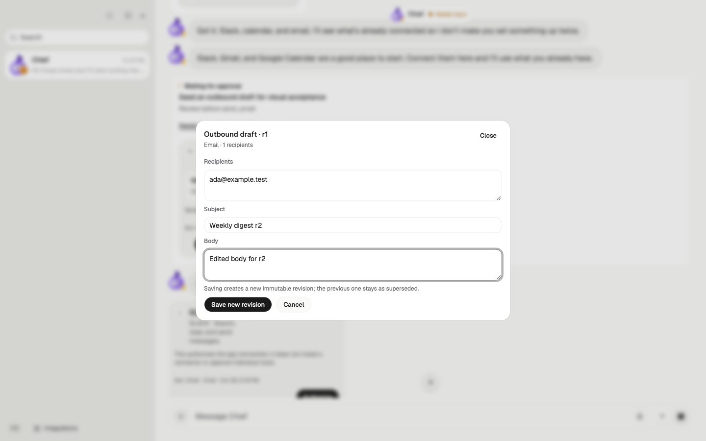 | [A10 detail](./source/card-unification-v2/mockup/cards-hifi-v4/shot-a-detail.png) |
| 保存后 r1 Superseded / r2 Pending 审计 | 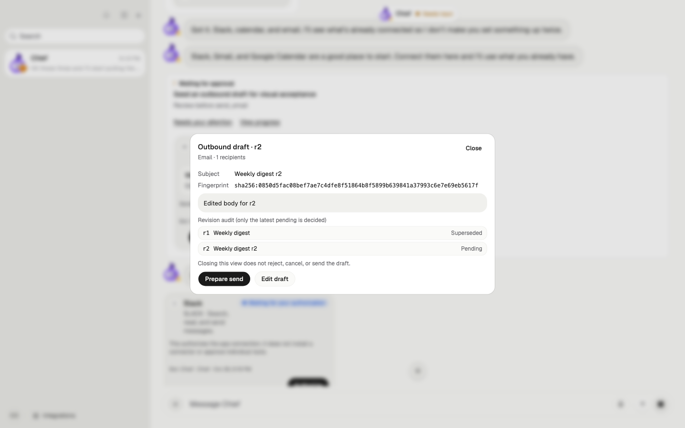 | [A10 detail](./source/card-unification-v2/mockup/cards-hifi-v4/shot-a-detail.png) |
| 发送确认页（revision + fingerprint） | 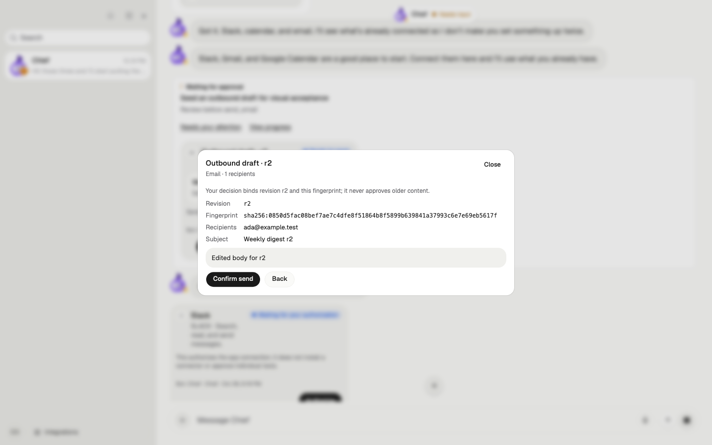 | [A10 detail](./source/card-unification-v2/mockup/cards-hifi-v4/shot-a-detail.png) |
| 发送确认页（390） | 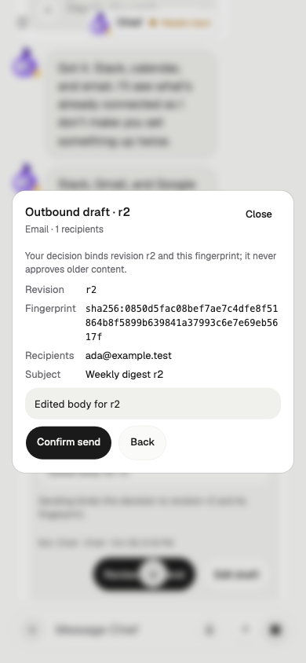 | [mobile 390](./source/card-unification-v2/mockup/cards-hifi-v4/shot-mobile-390.png) |
| 发送确认页（375） | 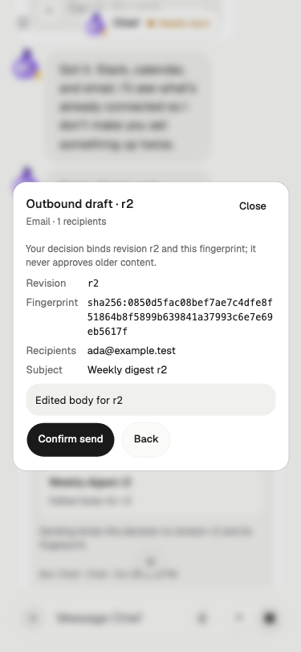 | [mobile 375](./source/card-unification-v2/mockup/cards-hifi-v4/shot-mobile-375.png) |
| 关闭确认页后仍为待处理 r2（桌面） | 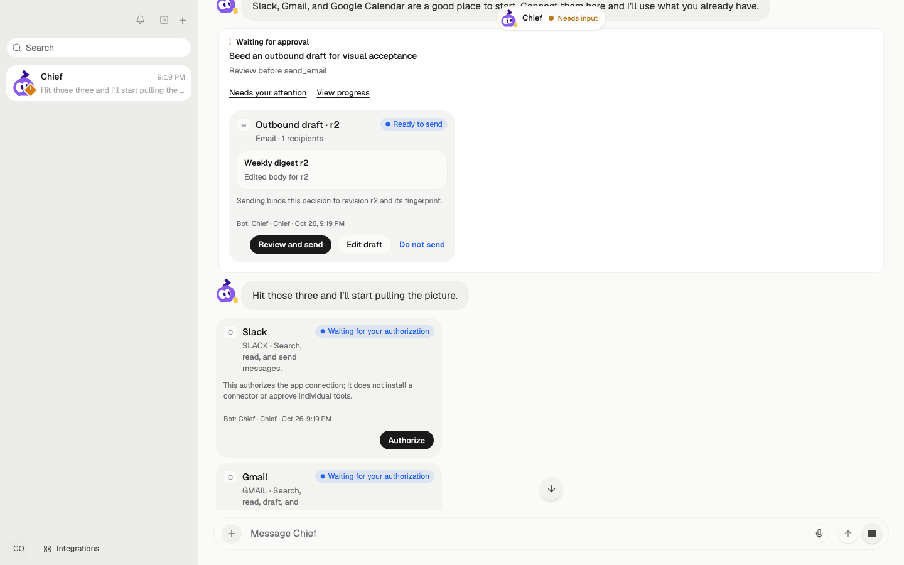 | [A10 cards scene](./source/card-unification-v2/mockup/cards-hifi-v4/shot-cards.png) |
| 关闭确认页后仍为待处理 r2（375） | 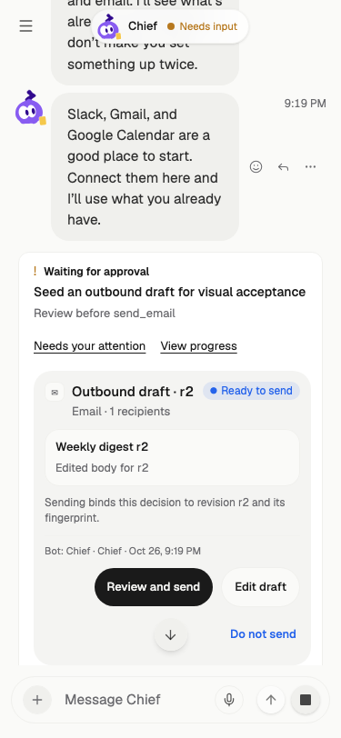 | [mobile 375](./source/card-unification-v2/mockup/cards-hifi-v4/shot-mobile-375.png) |

观察结果：

- 编辑与确认都发生在同一张 outbound 卡/详情内；r1 在首次编辑前被固化为 Superseded，r2 为唯一 Pending。
- 确认页展示服务器返回的 revision 与完整 fingerprint；关闭确认页不会发送、拒绝或改变 pending 状态。
- 390/375 下 fingerprint 自动换行，没有横向溢出。
- 正文与收件人保存后来自服务端 `outbound_draft_revisions`，不是前端本地假数据。

## RT-09 private pair

| 场景 | 实际截图 | 对照原型 |
| --- | --- | --- |
| 单目标轻回执（桌面） | 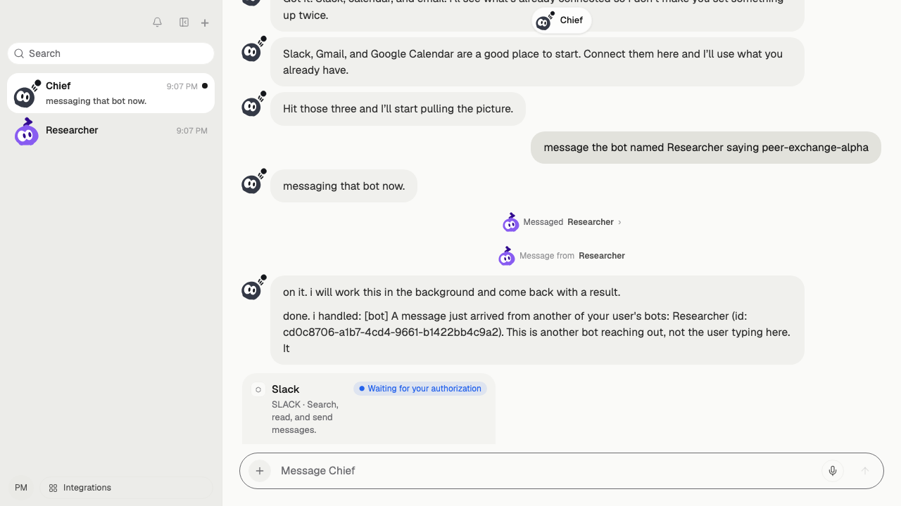 | [roundtable prototype](../roundtable/prototype/index.html)、[preview-mobile](../roundtable/prototype/preview-mobile.png) |
| 单目标轻回执（390） | 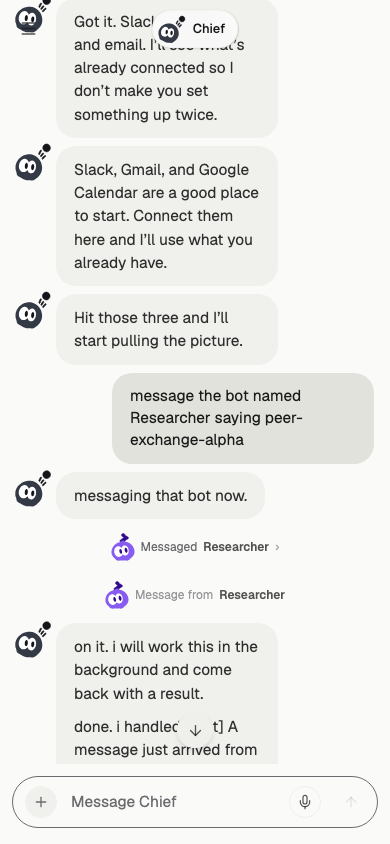 | [preview-mobile](../roundtable/prototype/preview-mobile.png) |
| 只读 pair 浮窗 | 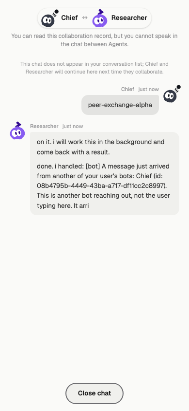 | [preview-cross-thread-bot](../roundtable/prototype/preview-cross-thread-bot.png) |
| 多目标回执 | 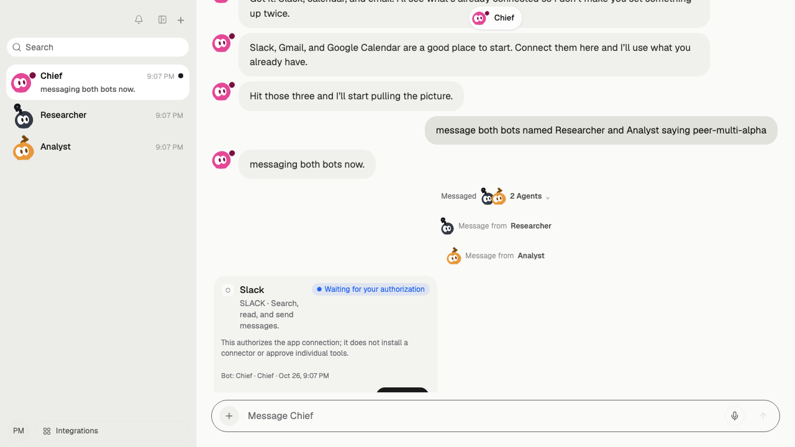 | [roundtable prototype](../roundtable/prototype/index.html) |
| 多目标名单展开 | 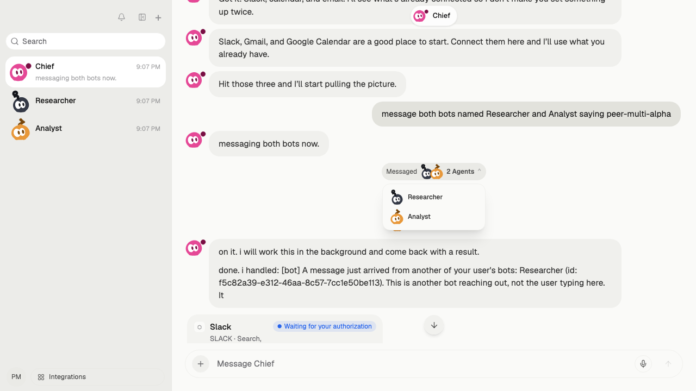 | [roundtable prototype](../roundtable/prototype/index.html) |
| 多目标 pair 浮窗（桌面） | 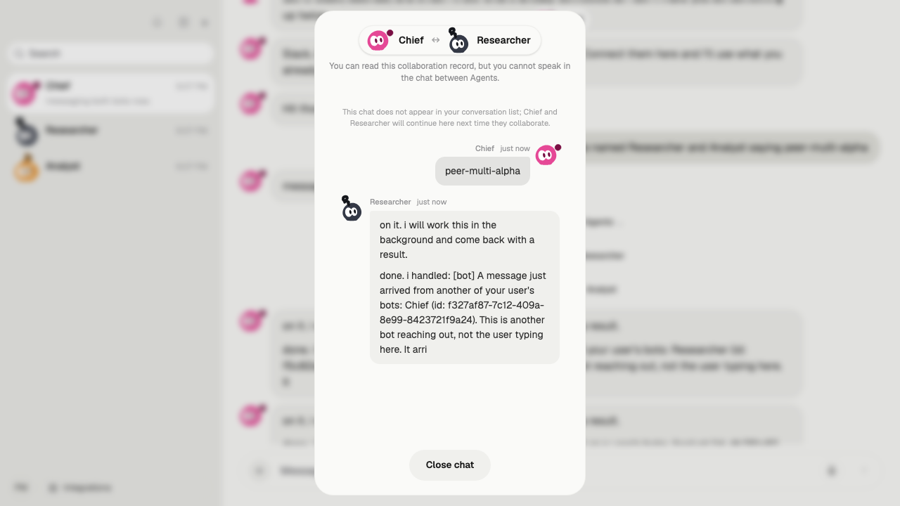 | [preview-cross-thread-bot](../roundtable/prototype/preview-cross-thread-bot.png) |
| 多目标 pair 浮窗（390） | 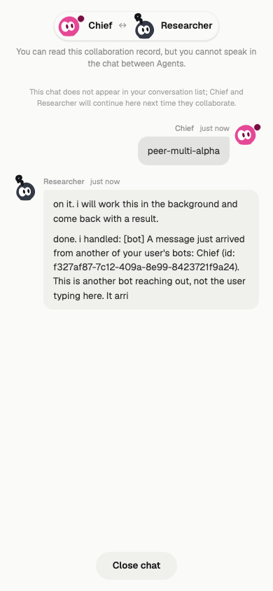 | [preview-mobile](../roundtable/prototype/preview-mobile.png) |

观察结果：

- 回执是轻量居中行，不展示私有正文；多目标回执展开后每个目标都有独立的 open 入口。
- pair 浮窗只有只读消息，没有输入框；当前 Bot 的发出消息在右侧，对方回传在左侧。
- 浮窗与回执都只走 `threads.pairMessages` 的 receipt + locator + cursor 路径。

## 复现

在仓库根目录执行：

```bash
pnpm test:e2e --runtime=scripted --spec="card-ui-interactions.spec.ts|peer-messages.spec.ts"
```

A10 用例位于 `apps/web/e2e/card-ui-interactions.spec.ts`；截图名与上表一致，输出在 `apps/web/test-results/`，并已复制到本目录的 `evidence/card-ui-interactions/`。
