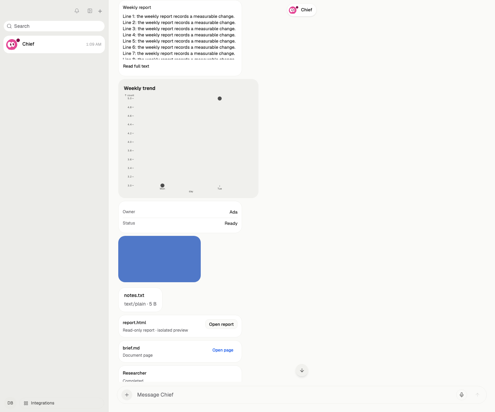
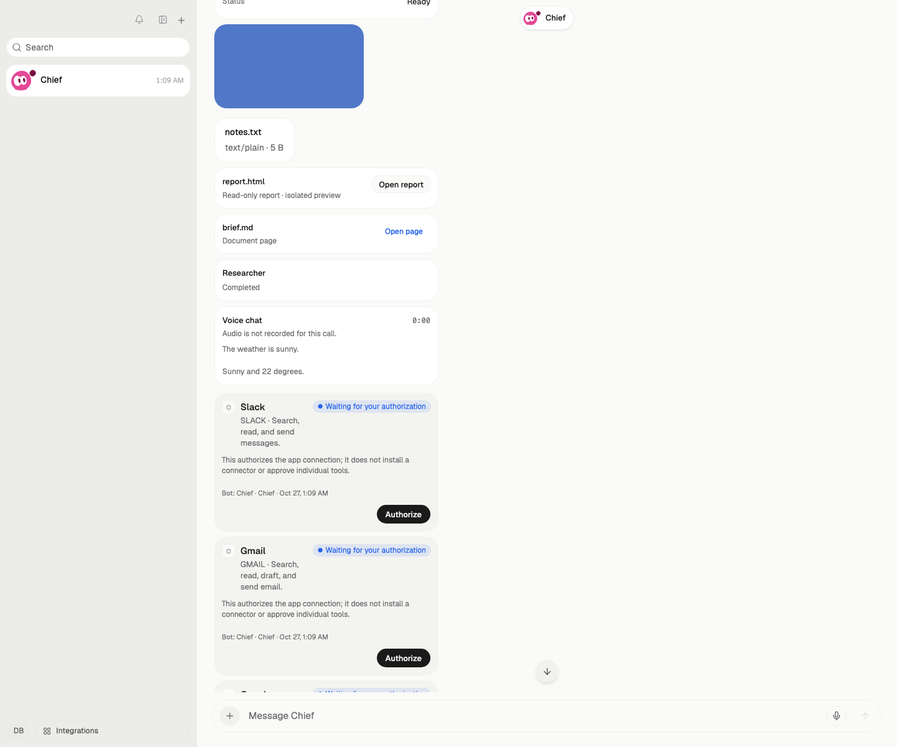
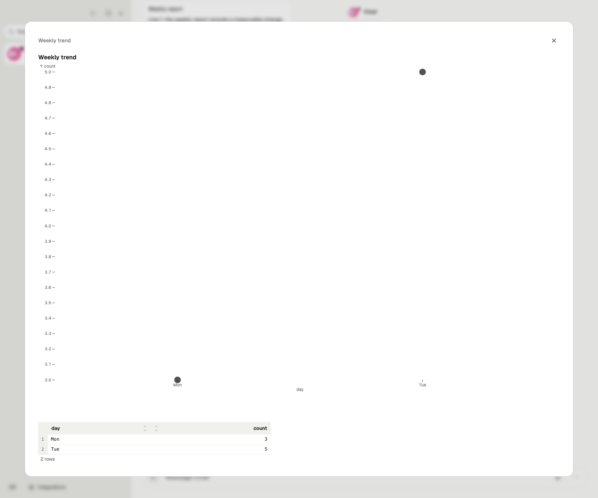
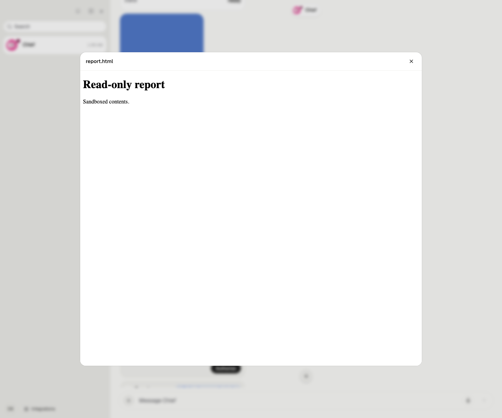
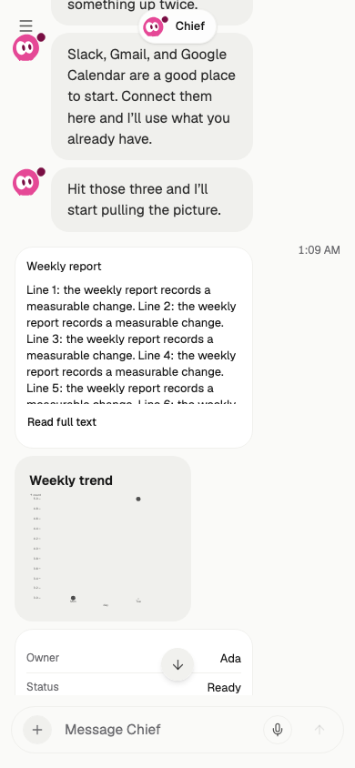
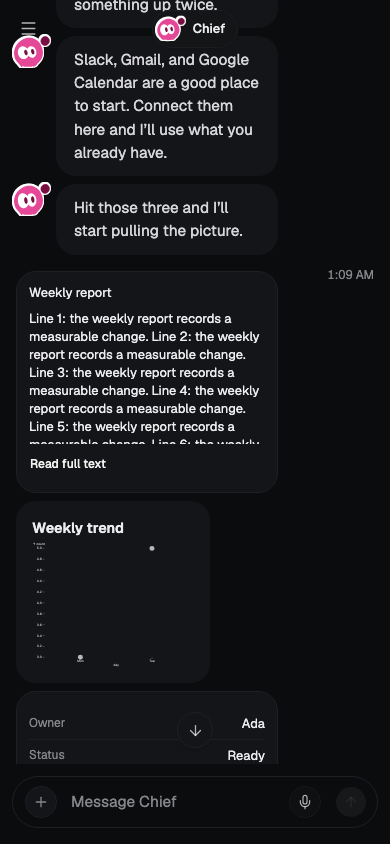
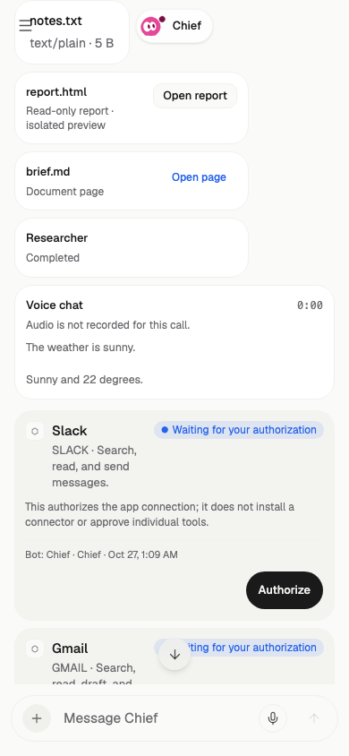
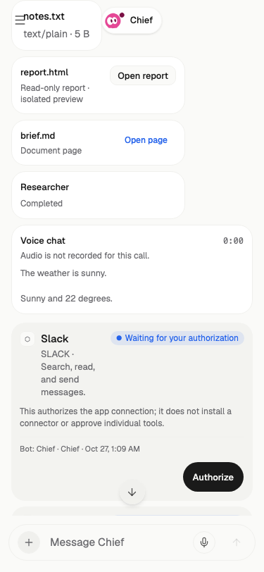

# CARD-01C visual evidence

状态：`captured`（2026-10-27）

这些截图来自真实页面、真实服务端投影和真实 artifact 存储：

- 运行方式：`pnpm test:e2e --runtime=scripted --spec=card-display-content.spec.ts`，一次性 `workpal_e2e_*` PostgreSQL 库。
- 测试账号创建一个 Bot，并通过生产 `artifacts/create` 上传 PNG/TXT/HTML/Markdown 四个真实 artifact；`/__e2e/display-blocks` 只写入 message blocks，九个 `DisplayBlock` 都由服务端 `card-interactions` 投影产生，没有前端 fixture。
- 387/375 截图同时断言页面无横向溢出；截图保留在 [evidence/card-display-content](./evidence/card-display-content/)。

## 展示族

| 场景 | 实际截图 | 对照原型 |
| --- | --- | --- |
| 长 Markdown 折叠、chart、collection、media/file、html、page、task_status、voice（上段） |  | [D1–D7 / B4–B5](./source/card-unification-v2/mockup/cards-hifi-v4/shot-cards.png) |
| 媒体、HTML、Page、task_status、voice（下段） |  | [V2–V4](./source/card-unification-v2/mockup/cards-hifi-v4/shot-a-detail.png) |
| 图表详情：可访问数据表替代 |  | [D3](./source/card-unification-v2/mockup/cards-hifi-v4/shot-cards.png) |
| HTML 只读报告详情（sandbox） |  | [D6 / V2](./source/card-unification-v2/mockup/cards-hifi-v4/shot-a-detail.png) |
| 390 顶部：长文折叠 + chart + collection |  | [mobile 390](./source/card-unification-v2/mockup/cards-hifi-v4/shot-mobile-390.png) |
| 390 深色 |  | [mobile 390](./source/card-unification-v2/mockup/cards-hifi-v4/shot-mobile-390.png) |
| 390 下段：media/html/page/task_status/voice |  | [mobile 390](./source/card-unification-v2/mockup/cards-hifi-v4/shot-mobile-390.png) |
| 375 下段 |  | [mobile 375](./source/card-unification-v2/mockup/cards-hifi-v4/shot-mobile-375.png) |

## 观察结果

- 长 Markdown 由高度折叠，展开入口打开完整正文；普通短回复仍走气泡，不改变原消息。
- 结构化 table 有真实 columns/rows、排序、分页、展开与复制；它不是 Markdown 表格增强。chart 的数据表是该图表真实 `data` 的 columns/rows 派生。
- collection 来自 legacy `card` KV 的只读兼容，没有批准、付款、发送、删除或授权控件。
- image 可放大；file 走真实 artifact 预览/下载；HTML 只在 `SandboxedHtmlViewer` 中打开；Page 打开现有 artifact 文档路由。
- task_status 只展示工作投影，不进入 attention queue；voice 展示真实 voice group 的 transcript 与 duration。当前 `voice_call` 没有音频 artifact，因此明确显示“Audio is not recorded for this call.”，不伪造播放。
- 390/375 无横向溢出；深色模式可读；卡片不使用整卡 opacity。

## 已知数据边界

- table 目前由 chart 的真实 `data` 派生为伴随数据表；没有独立的 table 模型/工具 producer。
- collection 来自 legacy `card` KV；没有新的 collection producer。
- Page 是现有 markdown/PDF artifact 的只读入口，不是新的 Page 实体。
- voice 只投影 voice group 的 transcript/duration；音频未持久化，播放控件保持缺失并明确说明。
- displayBlocks 已接入分页投影：历史分页接口按 gate 投影 displayBlocks，客户端按 blockId 首见优先合并，刷新与翻页展示一致。
